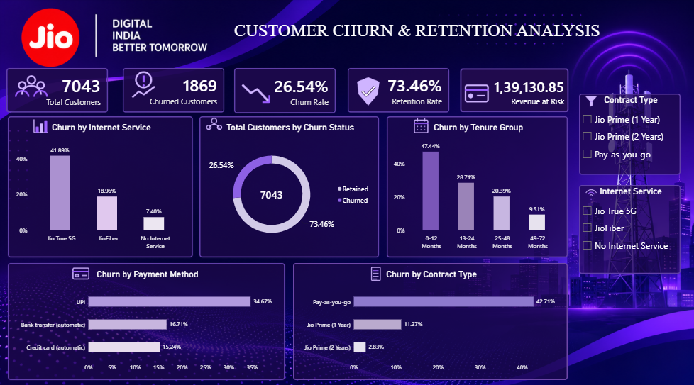
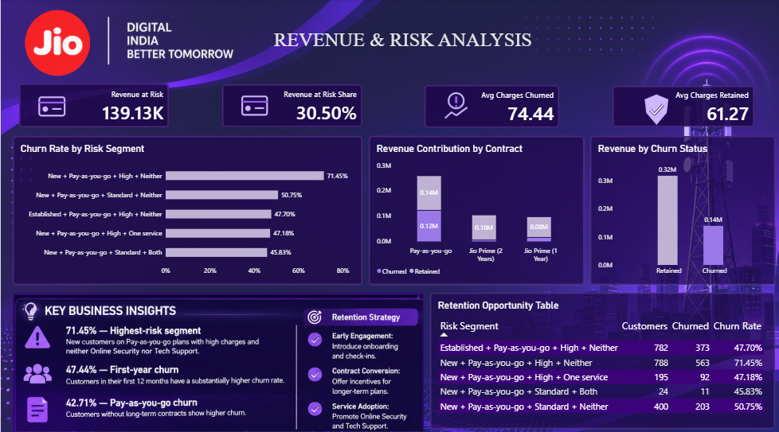

# Jio Telecom Customer Churn & Retention Analysis

An end-to-end data analytics project focused on understanding customer churn patterns, identifying high-risk customer segments, and evaluating monthly revenue exposure using **Google BigQuery, and Power BI**.

> **Dataset note:** This is an adapted, synthetic Jio-themed telecom dataset created for analytical and portfolio purposes. It is not verified actual Jio customer or company data.

## Project Overview

Customer churn affects customer retention and recurring revenue. This project analyzes customer demographics, service usage, contracts, payment methods, tenure, and monthly charges to identify patterns associated with churn.

The objective is to convert raw customer data into actionable business insights and retention recommendations.

## Tools & Technologies

- **Google BigQuery:** Data storage, SQL querying, cleaning, and analysis
- **Power BI:** Interactive dashboards and data visualization
- **Microsoft Excel / CSV:** Dataset handling

## Project Structure

```text
Customer_Churn_Analysis/
│
├── README.md
│
└── Jio_Churn_Analysis/
    ├── BIGQUERY_SQL/
    │   └── JIO_CHURN_ANALYSIS.sql
    │
    ├── dashboard/
    │   └── jio_churn_analysis.pbix
    │
    ├── data/
    │   └── Raw/
    │       └── Jio_Telecom_Churn.csv
    │
    └── screenshots/
        ├── Customer_Churn_and_Retention_Analysis.png
        └── Revenue_and_Risk_Analysis.png
```

## Data Preparation

The raw dataset was imported into BigQuery and prepared for analysis.

Key preparation activities:
- Inspected table structure and data types.
- Checked missing values and duplicate customer IDs.
- Converted `TotalCharges` from STRING to NUMERIC.
- Handled blank `TotalCharges` values using NULL.
- Created a cleaned table while preserving the raw table.

## Key Dataset Metrics

| Metric | Result |
|---|---:|
| Total Customers | 7,043 |
| Churned Customers | 1,869 |
| Retained Customers | 5,174 |
| Overall Churn Rate | 26.54% |
| Retention Rate | 73.46% |

## Business Analysis

The project covers 15 analytical areas, including:

1. Customer base analysis
2. Overall churn rate
3. Gender-wise churn
4. Tenure-based churn
5. Contract-wise churn
6. Internet service analysis
7. Payment method analysis
8. Senior citizen churn
9. Monthly charges analysis
10. Total charges analysis
11. Partner-based churn
12. Dependents-based churn
13. Add-on service analysis
14. Revenue at risk
15. High-risk customer segmentation

## Power BI Dashboard

### 1. Customer Churn & Retention Analysis

This dashboard provides an overview of customer churn patterns across internet services, tenure groups, payment methods, and contract types.



### 2. Revenue & Risk Analysis

This dashboard evaluates revenue associated with churned customers, compares monthly charges, and identifies high-risk customer segments.



## Key Business Insights

- The overall customer churn rate is **26.54%**.
- Customers with 0–12 months of tenure have a churn rate of **47.44%**.
- Pay-as-you-go customers show a churn rate of **42.71%**.
- Customers without Online Security have a churn rate of **41.77%**.
- Customers without Tech Support have a churn rate of **41.64%**.
- Churned customers account for **30.50% of total monthly charges**, compared with 26.54% of the customer base.
- The highest-risk identified segment has a churn rate of **71.45%**.

## Business Recommendations

1. Strengthen onboarding and customer engagement during the first year.
2. Encourage suitable long-term contract adoption.
3. Promote relevant add-on services such as Online Security and Tech Support.
4. Prioritize retention campaigns for high-risk customer segments.
5. Monitor monthly revenue exposure associated with customer churn.

## Project Deliverables

- BigQuery SQL analysis script
- Cleaned customer dataset
- Power BI dashboard (`.pbix`)
- Dashboard screenshots
- Business insights and recommendations

## Disclaimer

The dataset and Jio-themed branding are used for educational and portfolio demonstration purposes only. The analysis does not represent verified internal business information or actual Jio customer records.
